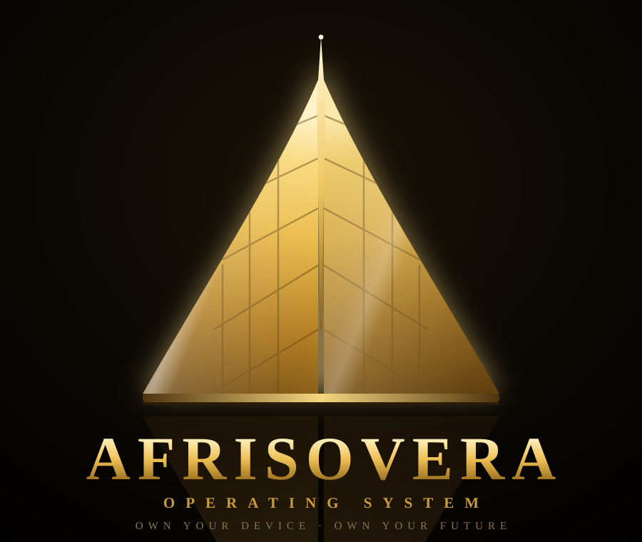
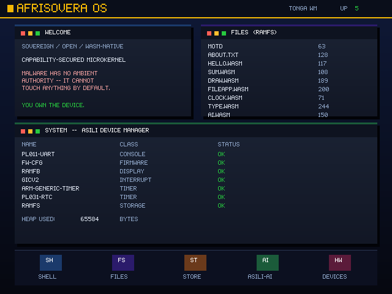
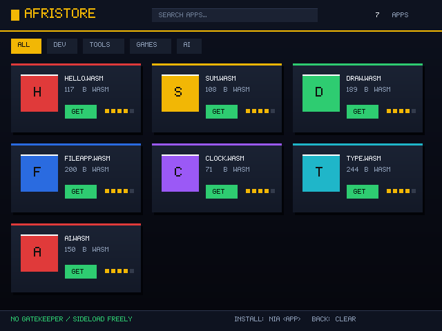
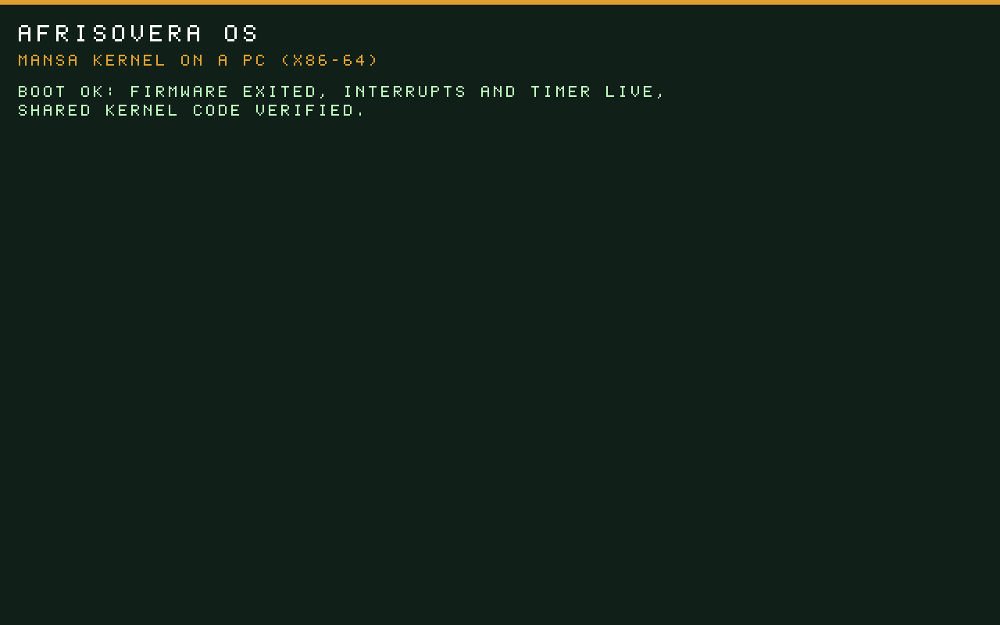

<p align="center">
  
</p>

<h1 align="center">AfriSovera OS</h1>

<p align="center">
  A new operating system written from scratch in Rust: its own capability-based microkernel,
  driver model, WebAssembly app runtime and desktop. Not an Android fork, not a Linux distribution.
</p>

<p align="center">
  <a href="LICENSE"></a>
  <a href="../../actions/workflows/ci.yml"></a>
  
</p>

---

## What it is

AfriSovera is an operating system built for people who should own their devices: light enough for a
low-cost phone or an old PC, secure because nothing gets authority it was not given, and open from the
kernel up. It is designed with the Global South in mind, and with everything the last twenty years of
mobile and desktop systems taught us.

| Part | What it does |
|---|---|
| **Mansa** | the microkernel, in Rust: memory, scheduling, interrupts, processes, capabilities and IPC |
| **Asili** | drivers and system services, behind a stable driver interface |
| **Nia** | the app runtime: every app is a sandboxed WebAssembly module that only sees what it was granted |
| **Tonga** | the window manager and desktop |
| **AfriStore** | the app store: signed apps, trust badges, sideloading allowed |
| **Daraja** | the bridge for foreign apps (today: Android permissions mapped to capabilities) |

The design documents in [`docs/`](docs) explain each part and the reasons behind it.

## Status, told honestly

AfriSovera is **pre-alpha**. It is **not** a phone OS you can install today, and it is not ready for
everyday use on a PC either.

**What works today:**

- **On a real PC**: the x86-64 kernel boots from a USB stick on a real UEFI laptop (first run on
  8 November 2026, an HP ENVY with Secure Boot off). It reaches the AfriSh shell, takes typing from the
  built-in keyboard, moves the pointer with the touchpad, opens the graphical desktop, and leaves the
  laptop's own Windows disk untouched. That run produced a list of field fixes, most now made and tested in
  QEMU; the rest wait for the next real-hardware test. Only one model of laptop has been tried so far.
- **On ARM**: QEMU only. The ARM kernel has not yet run on a physical board.

**Working and tested in QEMU** (more than 740 automated test suites, each booting the kernel and checking its
output; the PC drivers below are tested on QEMU's emulated hardware, and only some of them have met real
hardware yet):

- **ARM (AArch64)**: QEMU `virt` and Raspberry Pi 3 (`raspi3b`) builds from one codebase. MMU and paging,
  heap, GIC interrupts, a preemptive scheduler, a second CPU core (PSCI, cross-core interrupts and IPC),
  user-mode processes with private address spaces, system calls, a capability table and capability-checked
  IPC.
- **PC (x86-64, UEFI)**: the same kernel code booted by UEFI firmware, with its own page tables, ring-3
  processes, system calls, IPC and APIC-timer preemption. PC drivers: SATA (AHCI), NVMe, Intel e1000/igb and
  Realtek NICs, USB 3 (xHCI) keyboards, mice, hubs, hot-plug, sticks, touchscreens, network adapters, phone
  tethering (RNDIS), headsets and serial cables, PS/2 keyboard and touchpad, HD Audio, SD cards and eMMC
  (with multi-block transfers and DMA), the ACPI power button, GPT partitioning and an installer.
- **Networking**: virtio-net, ARP, IPv4, ICMP, UDP, DNS, a DHCP client, and TCP with data transfer,
  retransmission, out-of-order receive, clean close, and listening/serving connections.
- **Storage**: virtio-blk and a VFS whose files and system settings survive reboots.
- **Apps**: a WebAssembly interpreter (i32/i64/f32/f64, tables, globals) whose host calls are gated by
  capabilities, apps verified against a signed manifest before launch, and a parser hardened against
  malformed modules.
- **Crypto**: SHA-256, SHA-512 and Ed25519 (checked against the official test vectors) and a hash-DRBG
  random number generator seeded from hardware entropy.
- **Desktop**: the Tonga window manager, the AfriStore, a shell (AfriSh) with hundreds of commands, a
  formant speech synthesiser (`say`), and an on-device rule-based assistant (`ask`).

**Not done yet** (see the [roadmap](docs/05-roadmap.md)):

- running on a real phone or Raspberry Pi; on real PCs, wider testing beyond the first laptop (some USB
  devices behind Intel USB 3 controllers are not yet recognised at boot);
- Wi-Fi, a GPU driver, and the Sankofa UI framework;
- the assistant is rule-based, not a neural model; speech is formant synthesis, not neural TTS;
- Daraja maps Android permissions but does not yet run Android apps; the web renderer is a small HTML subset;
- the random number generator has not been formally audited, and nothing here has had a security audit.

## Screenshots

All taken in QEMU (photos from real hardware will follow).

| Desktop (ARM) | AfriStore | PC boot (x86-64, UEFI) |
|---|---|---|
|  |  |  |

## Build and run

You need:

- **Rust** through `rustup`. The toolchain is pinned in [`rust-toolchain.toml`](rust-toolchain.toml) (1.97.1,
  with the `aarch64-unknown-none` and `x86_64-unknown-uefi` targets); `rustup` installs it on first use.
- **QEMU 11** with `qemu-system-aarch64` and `qemu-system-x86_64` (older distribution builds fail some tests).
- **bash, Python 3 and `expect`** for the test scripts (Linux, macOS, or Git Bash on Windows).

```bash
git clone https://github.com/afrisovera-os/afrisovera.git
cd afrisovera

# the ARM kernel (QEMU virt)
cargo build -p mansa-kernel

# the PC kernel (an x86-64 UEFI application)
cargo build -p mansa-kernel --bin mansa-pc --features pc --target x86_64-unknown-uefi
```

Run it:

```bash
bash scripts/run-qemu.sh        # ARM kernel on QEMU virt, shell on the terminal
bash scripts/run-graphics.sh    # ARM kernel with a screen (the desktop)
bash scripts/run-raspi.sh       # Raspberry Pi 3 build on QEMU raspi3b
```

Test it:

```bash
bash scripts/smoke-test.sh                       # one suite: boot and check the core subsystems
bash scripts/pc-boot-test.sh                     # one suite: boot the PC kernel under UEFI
bash scripts/run-all-tests.sh --only smoke,heap  # a few suites through the runner
bash scripts/run-all-tests.sh                    # the whole registry (hours)
bash scripts/run-all-tests-pc.sh                 # the same registry against the PC kernel
```

Every suite boots QEMU, drives the shell, and grades what comes back. A suite prints its own verdict;
the runner records each one in a results file and prints a roll-up.
[`docs/13-developer-handoff.md`](docs/13-developer-handoff.md) has the full workflow and the known pitfalls.

## Continuous integration

- **[Quick checks](.github/workflows/ci.yml)**, on every push and pull request: builds both kernels, then
  runs a core set of suites on each architecture plus every suite the change touches.
- **[Full walk](.github/workflows/full-walk.yml)**, weekly and on demand: the whole registry, split across
  parallel runners, on the ARM kernel and (optionally) the PC kernel, with one combined roll-up.

## Roadmap

1. **Phase 0 to 2** (done in QEMU): kernel, userland, graphics, apps, networking, storage.
2. **PC track** (in progress): steps 1 to 3 are done (x86-64 kernel, the registry passing on it, real PC
   drivers), and the kernel has booted from a USB stick on a real laptop; next are the field fixes from that
   run, more machines, then installing.
3. **Phase 3**: real silicon (Raspberry Pi 4, PINE64, then a phone).
4. **Phase 4**: AfriCore services (identity, payments, push, sharing) and distribution.
5. **Phase 5**: hardening, audits and reach.

Details and the reasoning: [`docs/05-roadmap.md`](docs/05-roadmap.md).

## Documentation

| Doc | About |
|---|---|
| [00](docs/00-the-from-scratch-decision.md) | why from scratch, and how the app and driver gaps are met |
| [01](docs/01-kernel-mansa.md) | the Mansa microkernel |
| [02](docs/02-drivers-and-services-asili.md) | drivers and services (Asili) |
| [03](docs/03-app-runtime-and-sdk.md) | the app runtime and SDK (Nia) |
| [04](docs/04-the-toolchain.md) | the toolchain |
| [05](docs/05-roadmap.md) | the roadmap |
| [06](docs/06-universal-app-compatibility.md) | running apps from other platforms |
| [07](docs/07-phase-0-plan.md) | the build log |
| [08](docs/08-sovereignty-and-openness.md) | sovereignty and openness |
| [09](docs/09-asili-ai.md) | Asili AI |
| [10](docs/10-security-model.md) | the security model |
| [11](docs/11-driver-model.md) | the driver model |
| [12](docs/12-governance-and-model.md) | governance |
| [13](docs/13-developer-handoff.md) | developer handbook: build, run, test |
| [14](docs/14-asili-voice.md) | Asili Voice |
| [15](docs/15-hardware-bringup.md) | real-hardware bring-up |

## Contributing

Contributions are welcome: code, tests, documentation, hardware reports and design discussion.

- Read [`CONTRIBUTING.md`](CONTRIBUTING.md) and the [Code of Conduct](CODE_OF_CONDUCT.md).
- Open an issue before a large change, so the design can be agreed first.
- Every kernel change comes with a test suite (`scripts/<name>-test.sh`) that fails before the change and
  passes after it, and the existing suites must stay green.
- Report security problems privately, as described in [`SECURITY.md`](SECURITY.md), never in a public issue.

## Licence

AfriSovera OS is licensed under the [Apache License 2.0](LICENSE). See [`NOTICE`](NOTICE).
The project's names and logo are covered by the [trademark policy](TRADEMARK_POLICY.md).
